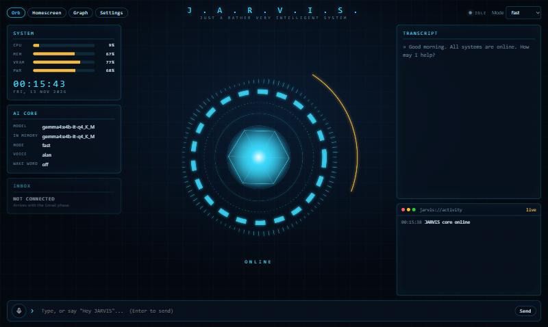

# JARVIS

A fully local, zero-cost personal voice assistant for Windows. The language model, speech recognition,
speech and wake word all run on your own machine: no cloud AI, no API keys.



## What works today

- **Chat** with a local model through Ollama, streamed as it is written. Conversations are saved.
- **Voice**: say "Hey JARVIS" and ask, in one breath or after it answers "Yes?". Replies are spoken, and it
  listens a few seconds for a follow-up. The wake word also interrupts a reply.
- **Three reasoning modes**: Fast and Balanced (Gemma 4 E4B), Advanced (Qwen 3.5 9B).
- **Three screens**: the orb (default), a homescreen dashboard, and a 3D graph of what JARVIS knows about.
  Switch by saying or typing "show homescreen", "show the graph", "go back".
- **Live system panel**: CPU, memory, GPU memory, battery.
- Runs as its own window. Closing the window stops everything.

It cannot control the PC, read mail or remember things across conversations yet. See the roadmap.

## Requirements

- Windows 11, Python 3.12 or newer, Microsoft Edge or Chrome
- [Ollama](https://ollama.com)
- An 8 GB GPU is what the default models are sized for. Speech runs on the CPU.

## Setup

```
git clone https://github.com/sidharth-vijayan/jarvis.git
cd jarvis
ollama pull gemma4:e4b-it-q4_K_M
ollama pull qwen3.5:9b
python -m venv .venv
.venv\Scripts\python -m pip install -r requirements.txt
.venv\Scripts\python -m piper.download_voices --data-dir data\voices en_GB-alan-medium en_US-ryan-medium en_GB-alba-medium
.venv\Scripts\python -c "from openwakeword.utils import download_models; download_models(['hey_jarvis'])"
```

The speech recognition model (Whisper) downloads itself on first use.

## Run

```
.venv\Scripts\pythonw jarvis.pyw
```

This starts the local server and opens the JARVIS window. Allow the microphone when asked. For a
desktop icon, make a shortcut to that command with the project folder as its working directory.

To run only the server and use a browser tab instead: `.venv\Scripts\python -m backend`, then open
http://127.0.0.1:8765.

## Using it

| To | Do |
|---|---|
| Ask by voice | "Hey JARVIS, what's the capital of Japan?" |
| Ask by text | Type in the bar at the bottom, Enter to send |
| Stop a reply | Press Stop, or say "Hey JARVIS" |
| Change screen | "show homescreen", "show the graph", "open settings", "go back" |
| Change voice, microphone, wake word | Settings |

If the wake word does not trigger, the status bar shows how close it came ("closest match 40%").
Lower `JARVIS_WAKE_THRESHOLD` (default `0.5`) if it is regularly just under.

## Roadmap

| Phase | Status |
|---|---|
| 1. Foundation: chat, storage, interface | Done |
| 2. Voice: speech in and out, wake word | Done |
| 3. Desktop control: apps, files, browser, WhatsApp | Next |
| Gmail: read and summarize mail | Planned |
| 4. Agent and memory | Planned |
| 5. Integrations: calendar, GitHub, Telegram | Planned |
| 6. Phone access | Planned |
| 7. Reminders and daily briefings | Planned |

## Layout

| Path | What it is |
|---|---|
| `backend/` | FastAPI server: chat (`main.py`), Ollama client (`llm.py`), speech and wake word (`voice.py`), SQLite (`db.py`) |
| `web/` | The interface in plain HTML, CSS and JavaScript, no build step |
| `jarvis.pyw` | Launcher: starts the server and opens the app window |
| `tests/` | Runnable checks: `python -m tests.test_backend`, `tests.test_voice`, `tests.test_wake` |
| `data/` | Created at runtime: conversations, voices, logs. Not in git |

## Configuration

Optional environment variables:

| Variable | Default | Purpose |
|---|---|---|
| `JARVIS_PORT` | `8765` | Local port |
| `JARVIS_OLLAMA_URL` | `http://127.0.0.1:11434` | Where Ollama listens |
| `JARVIS_WHISPER_MODEL` | `small.en` | `base.en` is about 3x faster, less accurate |
| `JARVIS_WAKE_THRESHOLD` | `0.5` | Lower triggers the wake word more easily |
| `JARVIS_KEEP_ALIVE` | `30m` | How long the model stays in memory after use |

The server listens on `127.0.0.1` only. If the app does not start, see `data/server.log`.

Third-party code in this repository: `web/vendor/3d-force-graph.min.js` (MIT license).
