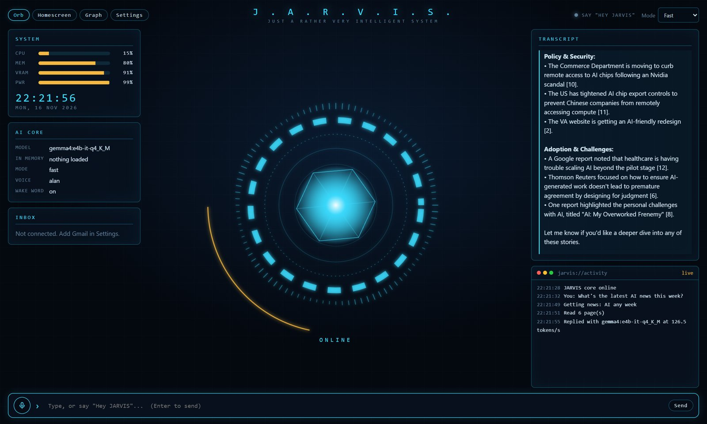
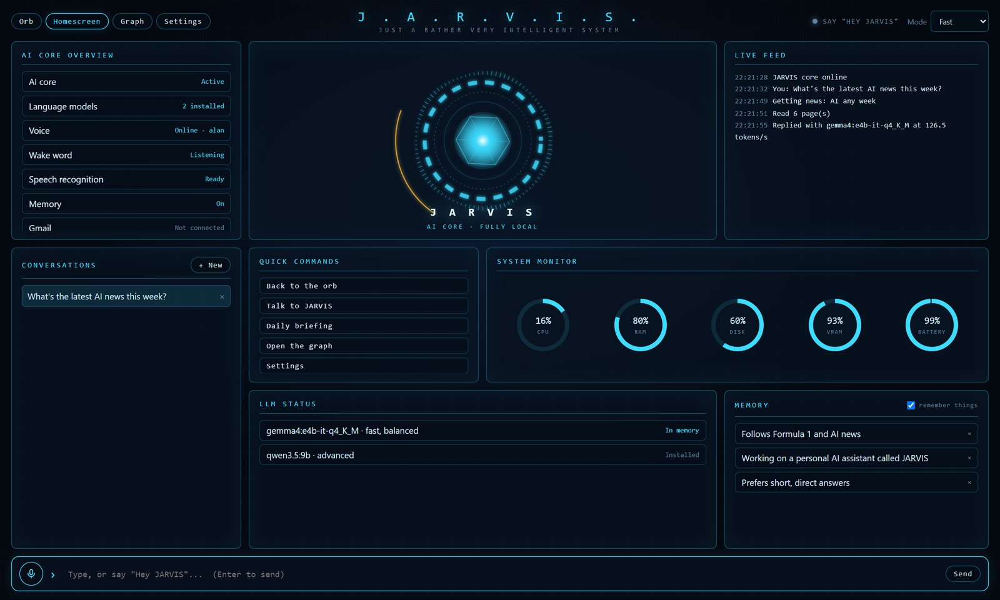
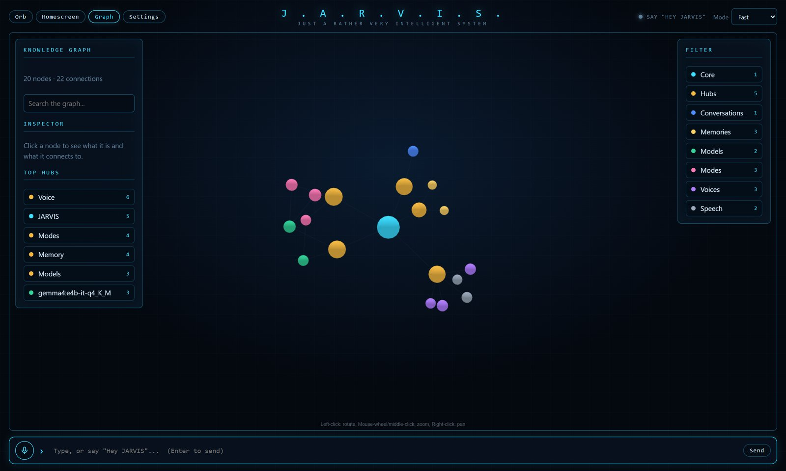

<h1 align="center">J.A.R.V.I.S.</h1>
<p align="center"><b>Just A Rather Very Intelligent System</b>: a personal AI assistant that runs entirely on your own laptop.</p>



Every Iron Man fan has wanted one. I wanted mine to be real: an assistant I can just talk to, that knows
my day, reads my mail, keeps me on top of deadlines and the news, and actually does things on my PC.

What I didn't want was another cloud chatbot with a monthly bill, sending my voice and my inbox to
someone else's servers. So JARVIS runs entirely on my laptop. The brain, the ears, the voice and the wake
word are all local models: no cloud AI, no API keys, no subscription. It costs nothing to run.

## What it can do

- **"Hey JARVIS"**: always listening for its name, even with the window closed, and it talks back.
- **Searches the web and reads the news**, with sources: *"latest Indian news"*, *"AI news this week"*,
  *"who won the last F1 race?"*
- **Knows your day**: Gmail, Google Calendar, GitHub, reminders, and a morning briefing that reads it
  all out.
- **Controls your PC**: opens apps (*"open Spotify"*), finds and summarizes documents, tidies folders.
- **Drives a browser for you**: searches sites, fills in forms, downloads files while you watch.
- **Remembers you** across conversations, and shows you everything it remembers so you can edit it.
- **Keeps watch** on websites and tells you when something changes.
- **Asks before it acts**: anything consequential waits for your approval, and destructive commands are
  refused outright.
- **Looks the part**: an arc-reactor HUD, a command-centre dashboard, and a 3D graph of everything it
  knows.

<table>
  <tr>
    <td></td>
    <td></td>
  </tr>
  <tr>
    <td align="center">Command centre</td>
    <td align="center">Knowledge graph</td>
  </tr>
</table>

## Under the hood

Gemma 4 and Qwen 3.5 through [Ollama](https://ollama.com) for the brain, Whisper for listening, Piper
for speaking, openWakeWord for "Hey JARVIS", all on one 8 GB laptop GPU. A FastAPI backend and a plain
HTML/CSS/JS interface, no build step.

## Get started

Needs Windows 11, Python 3.12+, Microsoft Edge and [Ollama](https://ollama.com).

```
git clone https://github.com/sidharth-vijayan/jarvis.git
cd jarvis
ollama pull gemma4:e4b-it-q4_K_M
python -m venv .venv
.venv\Scripts\python -m pip install -r requirements.txt
.venv\Scripts\python -m piper.download_voices --data-dir data\voices en_GB-alan-medium
.venv\Scripts\python -c "from openwakeword.utils import download_models; download_models(['hey_jarvis'])"
.venv\Scripts\pythonw jarvis.pyw
```

Allow the microphone, then say **"Hey JARVIS"**. Gmail, Calendar and GitHub connect from Settings.
For the smarter (slower) Advanced mode, also run `ollama pull qwen3.5:9b`.

---

<sub>3D graph by [3d-force-graph](https://github.com/vasturiano/3d-force-graph) (MIT).</sub>
